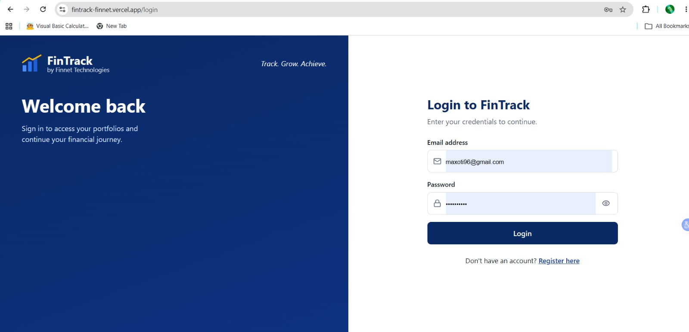
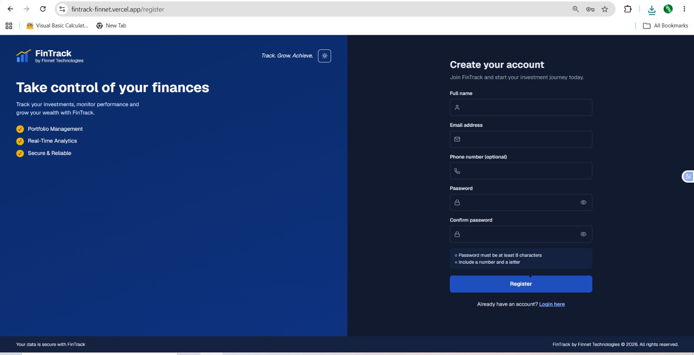
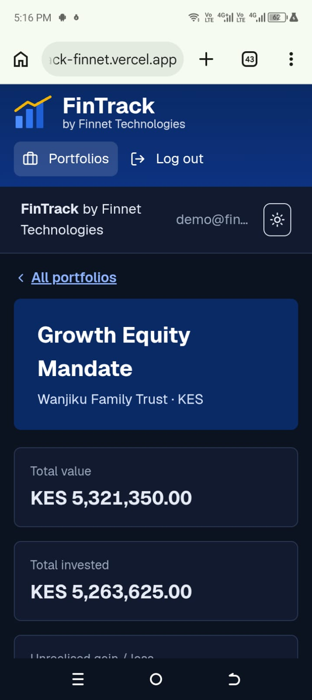
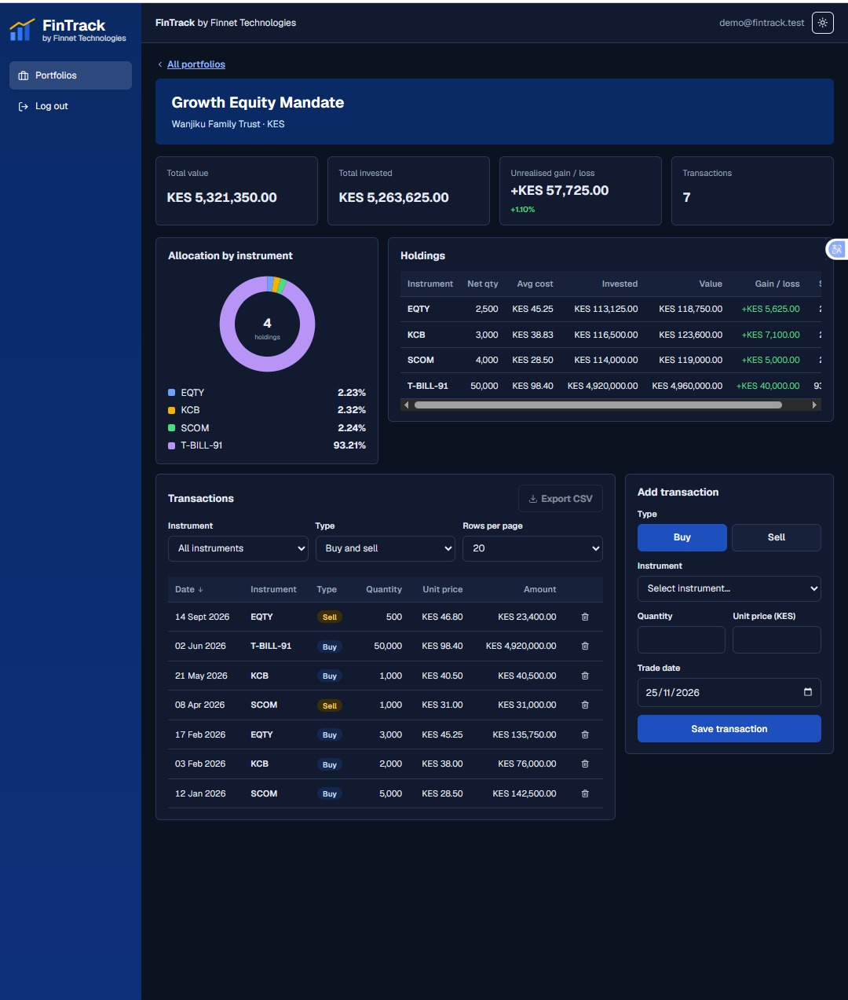
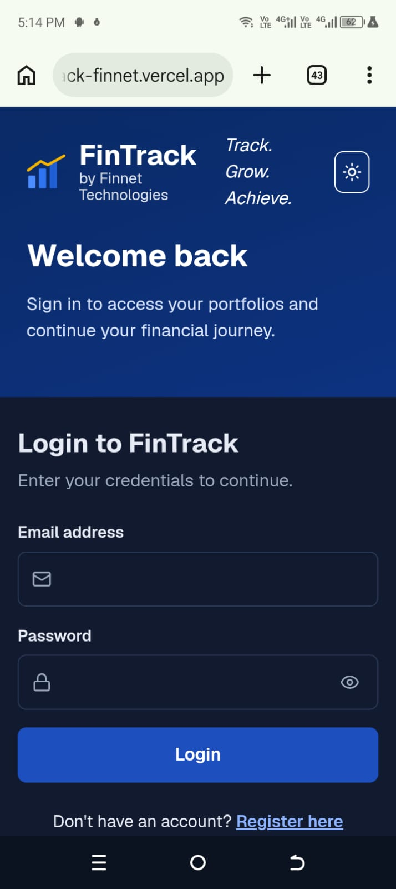
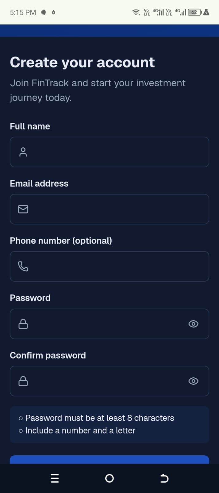
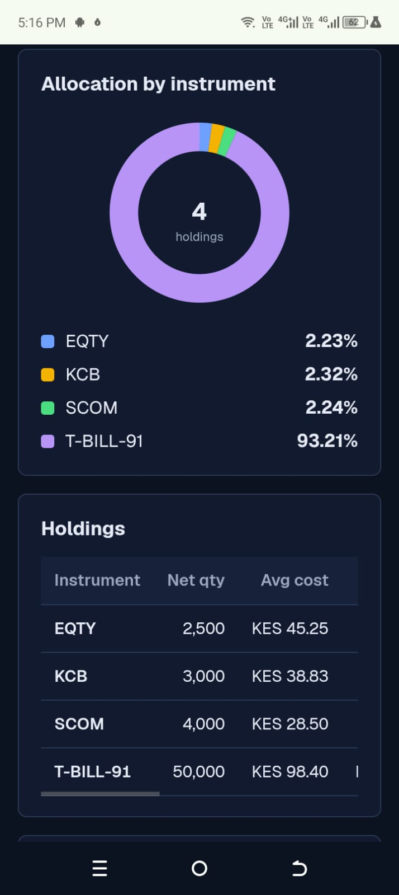
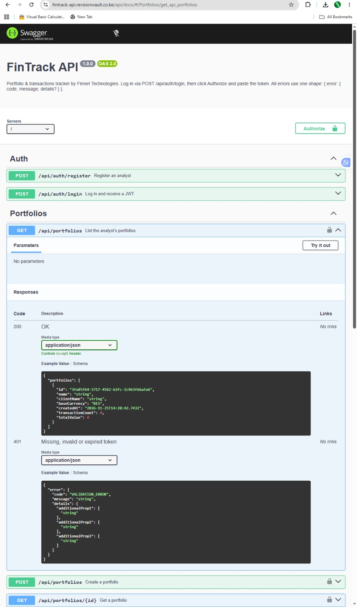
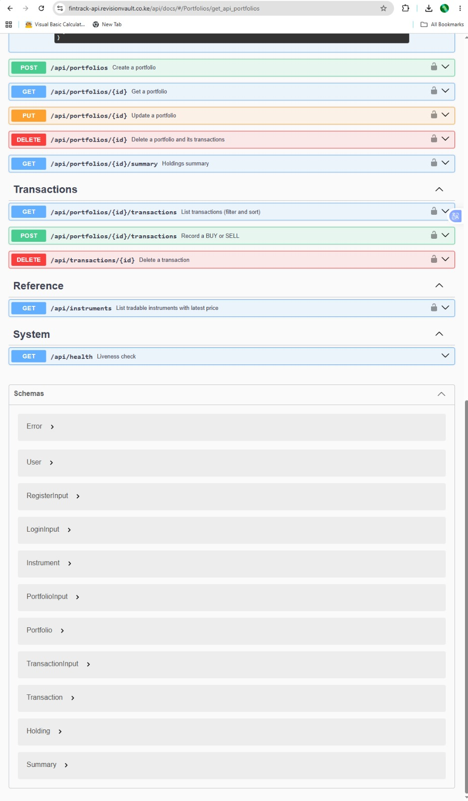

# FinTrack by Finnet Technologies

A branded portfolio and transactions tracker. An analyst registers client portfolios, records BUY/SELL transactions against them, and sees current holdings and a performance summary at a glance.

| | |
|---|---|
| **Live app** | https://fintrack-finnet.vercel.app/ |
| **Live API** | https://fintrack-api.revisionvault.co.ke |
| **Swagger / OpenAPI docs** | https://fintrack-api.revisionvault.co.ke/api/docs |
| **Health check** | https://fintrack-api.revisionvault.co.ke/api/health |
| **Demo login** | `demo@fintrack.test` / `Demo@1234` (pre-seeded with sample portfolios and transactions) |

| **Screenshots** | [see below](#screenshots) |
All data is fictional. The deployment stays running for at least 14 days after submission (until 9 December 2026).

## Architecture

```
Browser ──HTTPS/JSON──▶ Next.js frontend ──HTTPS/JSON──▶ Express REST API ──▶ PostgreSQL
                        (Vercel)                         (cPanel Node.js app,    (same cPanel host)
                                                          Node 22)
```

Monorepo layout:

```
/frontend            Next.js app (React, TypeScript): auth pages, dashboard, portfolio detail
/backend             Express + TypeScript REST API, schema.sql, seed.sql, tests
/deploy              cPanel deployment script
/.github/workflows   CI (lint, build, test) and CD (deploy to cPanel)
docker-compose.yml   Local API + database with Docker
.cpanel.yml          cPanel Git deployment tasks
```

## Tech stack and rationale

| Layer | Choice | Why |
|---|---|---|
| Frontend | Next.js, React, TypeScript | Familiar stack; file-based routing and a fast production build; type safety between pages and API types |
| Backend | Express, TypeScript | Small, explicit REST API with full control over validation, status codes and the error shape |
| Database | PostgreSQL | Strong constraints, enums and triggers, so money rules live in the database as well as the API |
| Auth | JWT bearer tokens, hashed passwords | Stateless, simple to protect every endpoint with one middleware |
| API docs | OpenAPI 3 via Swagger UI at `/api/docs` | Reviewers can try every endpoint from the browser |
| Tests | Vitest | Fast unit and API tests that run in CI |
| Hosting | Vercel (frontend), cPanel Node.js app + PostgreSQL (API and database) | The API host is an always-on cPanel account, so there is no free-tier sleep or expiry; it stays reachable for the 14-day review window |
| CI/CD | GitHub Actions | Lint, build and test on every PR; deploy to cPanel after CI passes on `main` |

## Data model and business rules

Defined in [`backend/schema.sql`](backend/schema.sql):

- **users**: analysts (email unique and stored lowercase, bcrypt hash, optional phone).
- **portfolios**: name, client name, base currency (`KES` or `USD`), created date; owned by one analyst. Analysts only ever see their own portfolios.
- **instruments**: reference data (`SCOM`, `KCB`, `EQTY`, `T-BILL-91`, plus fictional USD instruments) with a seeded `last_price`.
- **transactions**: instrument, `BUY`/`SELL`, quantity, unit price, trade date. Quantity and price must be positive.
- **holdings** (view): net quantity, average cost, total invested and total value per instrument, derived from transactions so it can never drift out of sync.

Rules enforced **in the database** (so they hold even if another code path bypasses the API):

- You cannot sell more than you hold, and you cannot delete a BUY that a later SELL depends on.
- A portfolio can only hold instruments quoted in its base currency (no FX conversion in this scope).

## Setup

Prerequisites: Node 22, PostgreSQL 14+.

```bash
git clone https://github.com/Maxoti/fintrack.git
cd fintrack

# Backend
cd backend
cp .env.example .env              # fill in the values (see below)
npm install
psql "$DATABASE_URL" -f schema.sql -f seed.sql    # creates tables and the demo user and sample data
npm run dev                       # API on http://localhost:4000

# Frontend (new terminal)
cd frontend
echo "NEXT_PUBLIC_API_URL=http://localhost:4000" > .env.local
npm install
npm run dev                       # app on http://localhost:3000
```

Swagger UI: http://localhost:4000/api/docs.

**With Docker:** `docker compose up --build` starts the API and database (see `docker-compose.yml`).

### Environment variables

Real values are never committed.

| Where | Variable | Purpose |
|---|---|---|
| Backend | see `backend/.env.example` | Database connection, JWT secret, and the allowed CORS origin |
| Frontend | `NEXT_PUBLIC_API_URL` | Base URL of the API, with no trailing slash and no `/api` (baked in at build time) |

## API overview

All endpoints except register, login and health require `Authorization: Bearer <token>`. Full request and response schemas are in Swagger.

| Method | Endpoint | Purpose |
|---|---|---|
| POST | `/api/auth/register`, `/api/auth/login` | Register an analyst and log in |
| GET, POST | `/api/portfolios` | List and create portfolios |
| GET, PUT, DELETE | `/api/portfolios/{id}` | Read, update and delete a portfolio |
| GET, POST | `/api/portfolios/{id}/transactions` | List and add transactions |
| DELETE | `/api/transactions/{id}` | Delete a transaction |
| GET | `/api/portfolios/{id}/summary` | Per-instrument net quantity, average cost, total invested, total value |
| GET | `/api/instruments` | Instruments available to trade |
| GET | `/api/health` | Liveness check |

Every error uses one JSON shape, with the matching HTTP status (validation errors, unknown resources, business-rule violations such as selling more than held):

```json
{ "error": { "code": "VALIDATION_ERROR", "message": "Quantity must be greater than 0", "details": { "quantity": ["..."] } } }
```

## Frontend

- Login and register with client-side validation, and server errors shown on the relevant field.
- Dashboard with the analyst's portfolios (create, edit and delete with a confirmation modal).
- Portfolio detail: holdings summary, add-transaction form and an allocation donut chart.
- Transactions table with sorting, filtering by instrument and type, pagination, and CSV export.
- Loading, empty and error states with a retry action; responsive layout down to 375px.
- Brand: "FinTrack by Finnet Technologies", a deep-navy primary with one amber accent and neutral greys, defined once as CSS variables in `frontend/app/globals.css`.
- Dark mode toggle that reuses the same design tokens.
- Accessibility: labelled inputs, visible focus styles, destructive actions behind a confirmation.

## Tests

```bash
cd backend && npm test            # Vitest: API behaviour, error handling, pagination and CSV helpers
cd frontend && npm run lint && npm run build
```

CI runs the same checks on every pull request.

## Deployment

**Frontend (Vercel):** the `frontend` folder is imported from GitHub; every merge to `main` deploys to production. `NEXT_PUBLIC_API_URL` is set in the Vercel project environment variables.

**API and database (cPanel):**

1. Create a PostgreSQL database and user in cPanel, then run `backend/schema.sql` and `backend/seed.sql` against it.
2. Create the Node.js app in cPanel (Node 22) pointing at the deployed backend directory.
3. Set the backend environment variables in the cPanel Node.js app settings. Secrets live only there, never in the repo. CORS is restricted to the frontend's origin.
4. Deployment is automated: a merge to `main` runs CI; when it passes, the deploy workflow triggers the cPanel Git deployment (`.cpanel.yml` running `deploy/cpanel-deploy.sh`), which copies the backend to the app directory, installs dependencies (including dev dependencies, which the TypeScript build needs) and builds it.
5. Verify with `GET /api/health` and the Swagger page.

**Uptime:** the API runs on an always-on cPanel account (no free-tier sleep), the database is on the same host, and the frontend is on Vercel. Liveness can be checked at any time at `/api/health`.

## Screenshots

Images are in [`docs/screenshots`](docs/screenshots).

### Login and register

<p>
  
  
</p>

### Dashboard



### Portfolio detail with holdings and chart



### Mobile layout (375px)

<p>
  
  
  
  
</p>

### Swagger docs

Live API docs: https://fintrack-api.revisionvault.co.ke/api/docs

<p>
  
  
</p>


## Assumptions

- **Average cost** is the weighted average of BUY prices (total buy cost divided by total bought quantity). Total invested is net quantity multiplied by average cost.
- **Total value** uses each instrument's seeded latest price. There is no live market feed.
- **Currency:** each portfolio has one base currency and can only hold instruments quoted in it. No FX conversion.
- **Overselling** is checked against total net quantity, not by trade date, so a backdated SELL that precedes its BUY is allowed.
- Portfolios belong to the analyst who created them; analysts cannot see each other's data.

## Trade-offs

- **Token storage:** the JWT is kept in `localStorage` for simplicity. An httpOnly cookie would resist XSS better but needs extra cross-domain cookie and CORS handling between Vercel and the API host.
- **Instruments are a fixed reference table**, so an unknown symbol is rejected rather than created on the fly.
- **Simple average cost** rather than a running cost basis: if a position is fully sold and later re-bought, a running method would give a different figure.
- **Shared cPanel hosting** keeps the API alive for the review period at no extra cost, but deploys are slower and more constrained than on a container platform. Docker Compose is provided for local development.
- Scope was limited to the core flows; polish and bonus items were prioritised below correctness and deployment.

## Next steps

- Live market prices and FX conversion.
- Running cost-basis accounting and realised P&L on SELLs.
- httpOnly cookie sessions with refresh tokens.
- Frontend component and end-to-end tests.
-

## AI tool usage


AI-assisted development tools were used during this project to support selected aspects of the software engineering process.

**Claude (Anthropic)** was used to assist with:
- Debugging and troubleshooting build and deployment issues.
- Reviewing implementation approaches and exploring potential solutions.

AI-generated suggestions and outputs were reviewed, evaluated, and adapted before being incorporated into the project. The final implementation decisions, code integration, testing, and validation remained my responsibility.

AI tools served as development aids and did not replace the engineering, implementation, or verification work performed during the project.